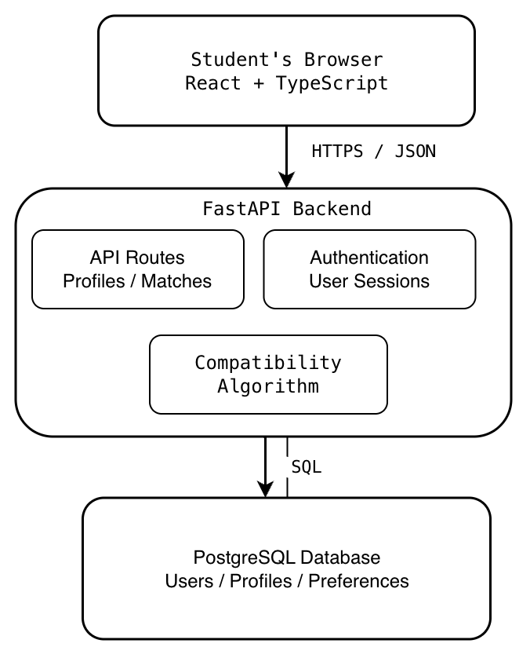
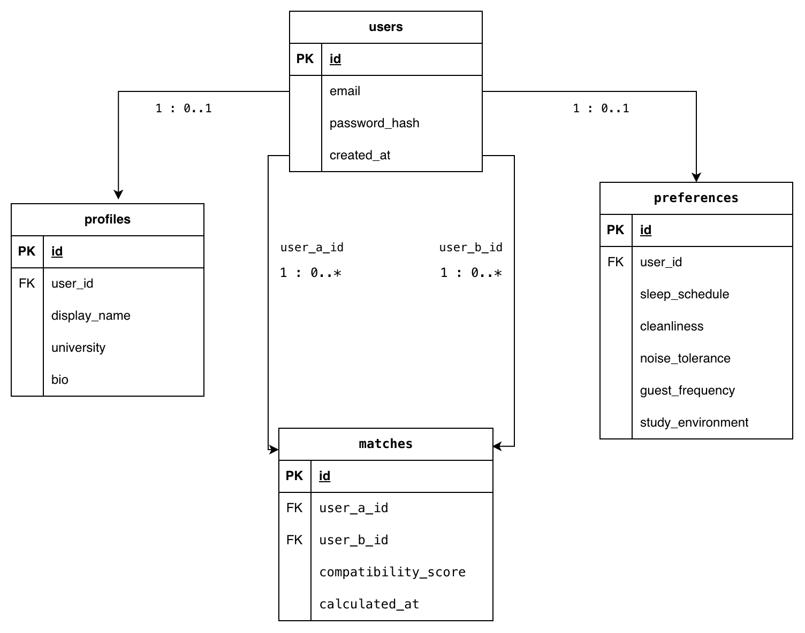

# Roommate Adapt
## System Design Document

### 1. Architecture Overview

#### System Architecture Diagram

Roommate Adapt uses a three-tier web application architecture.

**Frontend:** React with TypeScript and Tailwind CSS provides the user interface.

**Backend:** Python with FastAPI handles requests, business logic, and roommate compatibility calculations.

**Database:** PostgreSQL stores student profiles, lifestyle preferences, and application data.

### 2. System Components

- Authentication and user management
- Student profile management
- Lifestyle questionnaire
- Compatibility scoring engine
- Roommate discovery
- PostgreSQL database

### 3. Database Design

#### Entity Relationship Diagram (ERD)

#### Database Overview

Roommate Adapt uses PostgreSQL as its relational database management system. The initial database schema consists of four core tables:

- **users:** Stores user accounts, email addresses, hashed passwords, and account creation timestamps.
- **profiles:** Stores student profile information, including display names, universities, and biographies.
- **preferences:** Stores lifestyle habits and roommate preferences used by the compatibility algorithm.
- **matches:** Stores compatibility scores calculated between pairs of users.

#### Database Relationships

- Each user can have zero or one profile.
- Each user can have zero or one preferences record.
- Each user can participate in multiple roommate compatibility matches.
- Each match references two users through the foreign keys `user_a_id` and `user_b_id`.

#### Data Integrity

Primary keys use UUIDs, while foreign keys enforce relationships between tables.

Unique constraints on `profiles.user_id` and `preferences.user_id` ensure that each user has at most one corresponding record in each table.

The database schema supports user authentication, student profile management, lifestyle preference storage, and roommate compatibility calculations. It also provides a foundation for future application development.

### 4. Application Workflow

Roommate Adapt follows a structured workflow that allows students to create accounts, provide lifestyle preferences, and discover compatible roommates.

#### Step 1: User Registration and Login

Students create an account using their email address and password. The backend securely processes authentication and stores hashed passwords in PostgreSQL.

#### Step 2: Profile Creation

After registering, students create a profile containing their display name, university, and a short biography.

#### Step 3: Lifestyle Questionnaire

Students complete a questionnaire covering lifestyle habits and roommate preferences, including:

- Sleep schedule
- Cleanliness
- Noise tolerance
- Guest frequency
- Study environment

Responses are stored in the preferences table.

#### Step 4: Compatibility Calculation

The FastAPI backend processes students' lifestyle preferences using a weighted compatibility algorithm.

The algorithm compares relevant preferences and calculates a compatibility score for potential roommate pairs.

#### Step 5: Roommate Recommendations

Students receive roommate recommendations based on their compatibility scores.

Each recommendation displays relevant profile information and a compatibility score to help students evaluate potential roommates.

#### Step 6: Profile and Preference Updates

Students can update their profiles and lifestyle preferences. Compatibility scores can be recalculated when relevant preferences change.

### 5. Compatibility Matching Algorithm

#### Overview

Roommate Adapt uses a weighted compatibility algorithm to compare students based on lifestyle habits and shared living expectations.

The algorithm calculates a compatibility score between 0 and 100, with higher scores indicating greater similarity across the selected lifestyle categories.

#### Lifestyle Categories and Weights

| Category | Weight |
|---|---|
| Sleep Schedule | 25% |
| Cleanliness | 25% |
| Noise Tolerance | 20% |
| Guest Frequency | 15% |
| Study Environment | 15% |
| **Total** | **100%** |

These weights are initial design assumptions and may be refined through testing and user feedback.

#### Compatibility Calculation

For each category, the algorithm calculates a similarity score between 0 and 100.

The overall compatibility score is calculated using:

Compatibility Score =
(Sleep Similarity × 0.25) +
(Cleanliness Similarity × 0.25) +
(Noise Similarity × 0.20) +
(Guest Similarity × 0.15) +
(Study Similarity × 0.15)

The resulting score ranges from 0 to 100.

#### Similarity Rules

For numerical preferences measured on a scale of 1 to 5, similarity is calculated as:

Similarity = 100 × (1 - |A - B| / 4)

For categorical preferences, the initial algorithm assigns:

- 100 for matching categories.
- 50 when either student's selection is flexible.
- 0 for conflicting non-flexible categories.

When both students select flexible, the similarity is 100.

These rules are preliminary and will be validated through test cases.

#### Match Ranking

The system calculates compatibility scores between eligible students and sorts recommendations from highest to lowest score.

Users cannot be matched with themselves. Duplicate unordered pairs are prevented.

#### Future Enhancement: Personalized Weights

A future version of Roommate Adapt will allow students to assign importance weights to individual lifestyle categories.

Personalized weights will support different living priorities, such as cleanliness, quiet environments, and guest frequency.

The future matching algorithm will consider both students' importance weights to produce a balanced compatibility score.

### 6. API Design

#### Overview

Roommate Adapt uses a RESTful API built with Python and FastAPI.

The React frontend communicates with the backend through HTTP requests using JSON.

#### Authentication Endpoints

| Method | Endpoint | Description |
|---|---|---|
| POST | /api/auth/register | Register a new student account |
| POST | /api/auth/login | Authenticate an existing student |
| GET | /api/users/me | Retrieve the authenticated user's account information |

#### Profile Endpoints

| Method | Endpoint | Description |
|---|---|---|
| GET | /api/profiles/me | Retrieve the authenticated user's profile |
| PUT | /api/profiles/me | Create or update the authenticated user's profile |
| GET | /api/profiles/{user_id} | Retrieve another student's public profile |

#### Preference Endpoints

| Method | Endpoint | Description |
|---|---|---|
| GET | /api/preferences/me | Retrieve the authenticated user's lifestyle preferences |
| PUT | /api/preferences/me | Create or update lifestyle preferences |

#### Matching Endpoints

| Method | Endpoint | Description |
|---|---|---|
| GET | /api/matches | Retrieve ranked roommate recommendations |

#### API Security

- Passwords must be securely hashed before database storage.
- Protected endpoints require valid authentication.
- Users can only modify their own profiles and preferences.
- Sensitive account information must not be exposed through public profile endpoints.
- Requests must be validated before processing.
- API errors must return appropriate HTTP status codes and helpful messages.

#### Data Exchange

The frontend sends and receives JSON data.

The backend validates requests, performs business logic, communicates with PostgreSQL, and returns structured responses.
